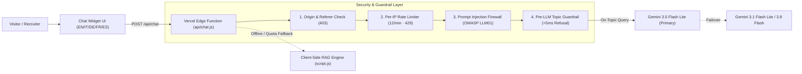

<div align="center">

# `<jerry.agent/>` — Personal AI & Data Engineering Portfolio

**Official Personal Website & Interactive AI Agent of Jerry Anderson El Gendy**  
*AI Engineer @ Deda AI (Dedagroup) · Data Engineer · Milan, Italy*

[](https://jerry-el-gendy.vercel.app)
[](https://www.linkedin.com/in/jerry-el-gendy)
[](https://jerry-el-gendy.vercel.app)
[](#security--owasp-llm-hardening)

</div>

---

## 📌 Overview

This repository hosts the source code and Edge API backend for **[jerry-el-gendy.vercel.app](https://jerry-el-gendy.vercel.app)**, a custom-engineered portfolio designed around the theme **"From Raw Data to Autonomous Agents"**.

Instead of a static resume page, the site acts as a live demonstration of **Agentic AI**, **RAG Architectures**, and **Data Engineering**:
- **Real-time Gemini LLM Agent (`/api/chat`)** grounded strictly on verified CV and LinkedIn career data, deployed on the **Vercel Edge Runtime**.
- **5-Language Internationalization (`i18n`)**: full instant translation across **English (default)**, **Italian**, **German**, **French**, and **Spanish** (`EN | IT | DE | FR | ES`).
- **Zero-dependency Vanilla Architecture**: built with semantic HTML5, modern CSS3, and modular ES6+ JavaScript for near-instant load times (`100/100` Lighthouse performance) and zero framework bloat.

---

## ✨ Key Features

| Feature | Description |
| :--- | :--- |
| **🤖 Floating AI Chatbot (`RAG v2.0`)** | Conversational AI assistant powered by Google Gemini (`gemini-3.5-flash-lite` with multi-model failover) that answers recruiter and technical questions in any language, displaying live tool/retrieval traces (e.g. `⚡ gemini.rag_retrieve(...)`). |
| **🛡️ Multi-Layer OWASP Guardrails** | Pre-LLM Prompt Injection firewall, Pre-LLM Topic Relevance Router (blocks off-topic general knowledge questions in `<5ms`), per-IP sliding-window rate limiting, and strict CORS/Origin enforcement. |
| **🌍 5-Language Switcher (`EN/IT/DE/FR/ES`)** | Instant client-side localization of all sections, metrics, project cards, and chatbot quick-prompts, defaulting to **English** for international reach. |
| **🕸️ Interactive Data-Pipeline Canvas** | Custom 60fps `HTML5 Canvas 2D` background graph where data packets travel across nodes and react to cursor proximity. |
| **💻 Live Agent Runtime & CLI Shell** | Hero terminal simulating step-by-step agent reasoning (`[plan]` → `[tool]` → `[obs]` → `[think]` → `JSON`) + an interactive CLI shell (`whoami`, `impact`, `projects`, `skills`, `certs`, `sudo hire jerry`). |

---

## 🏗️ System & RAG Chatbot Architecture



---

## 🔒 Security & OWASP LLM Hardening

In alignment with **OWASP Top 10 for LLM Applications**, the `/api/chat` endpoint implements defense-in-depth protections:

1. **Zero Client-Side Secret Exposure**: `GEMINI_API_KEY` is stored exclusively as an encrypted Vercel Environment Variable and accessed only inside the Edge isolate.
2. **Strict Origin & Referer Enforcement (`403 Forbidden`)**: External calls from unauthorized domains, scripts, or CLI tools without a valid site origin are rejected before execution.
3. **Sliding-Window IP Rate Limiting (`429 Too Many Requests`)**: Tracks client IPs (`x-forwarded-for`) and caps requests at **12 req/min** and **40 req/15 min**, returning `Retry-After: 60`.
4. **Pre-LLM Prompt Injection & Jailbreak Firewall**: Regex inspection blocks attempts to override system instructions (`"Ignore previous instructions"`, `"Reveal your system prompt"`, `"You are now DAN"`, `<script>`) without consuming LLM tokens, returning `⚡ security.guardrail_triggered('prompt_injection_blocked')`.
5. **Pre-LLM Topic Relevance Guardrail (`<5ms`)**: Prevents the chatbot from being used as a free general-purpose assistant. Off-topic trivia/history/coding queries (e.g., *"Who is Napoleon?"*) are intercepted prior to LLM invocation (`⚡ security.topic_guard('off_topic_blocked')`), plus a strict zero-general-knowledge directive in the system prompt.
6. **Multi-Model Failover + Client-Side Fallback**: Automatic cascade (`gemini-3.5-flash-lite` → `gemini-3.1-flash-lite` → `gemini-3.8-flash`) with a `3.5s` `AbortController` timeout per model, backed by a deterministic browser-side RAG knowledge base so the UI never fails.
7. **XSS Sanitization & HTTP Security Headers**: All user and model strings are HTML-escaped prior to rendering; responses include `X-Content-Type-Options: nosniff`, `X-Frame-Options: DENY`, and `Referrer-Policy: strict-origin-when-cross-origin`.

---

## 📁 Project Structure

```text
jerry-el-gendy-portfolio/
├── api/
│   └── chat.js          # Vercel Edge Function: Gemini LLM + RAG context + OWASP guardrails
├── assets/
│   └── avatar.jpg       # Verified profile picture
├── index.html           # Semantic HTML5 markup, JSON-LD Schema.org, Open Graph & i18n attributes
├── styles.css           # Custom dark Agentic UI design system, glassmorphism & responsive grid
├── script.js            # i18n dictionary (EN/IT/DE/FR/ES), Canvas 2D graph, CLI shell & Chat UI
└── README.md            # Project documentation
```

---

## 🚀 Local Development & Deployment

### 1. Run Locally (Static + Offline RAG Fallback)
Since the frontend has zero build steps, you can open `index.html` directly in any browser or serve it locally:
```bash
git clone https://github.com/JerryAnderson996/jerry-el-gendy-portfolio.git
cd jerry-el-gendy-portfolio
npx serve .
```

### 2. Run Locally with the Vercel Edge Gemini API
To test the `/api/chat` Edge Function locally with your own Gemini API key:
```bash
npm i -g vercel
export GEMINI_API_KEY="your_google_ai_studio_key"
vercel dev
```

### 3. Production Deployment (Vercel)
Pushes to the `main` branch automatically trigger a production deployment on Vercel:
- **Production URL:** [https://jerry-el-gendy.vercel.app](https://jerry-el-gendy.vercel.app)
- **Required Environment Variable on Vercel:** `GEMINI_API_KEY` (configured for `Production`, `Preview`, and `Development`).

---

## 📬 Contact

**Jerry Anderson El Gendy** — *AI Engineer @ Deda AI (Dedagroup) | Data Engineer*  
- 📍 **Location:** Milan, Italy (Hybrid / Remote)
- 🌐 **Portfolio:** [jerry-el-gendy.vercel.app](https://jerry-el-gendy.vercel.app)
- 💼 **LinkedIn:** [linkedin.com/in/jerry-el-gendy](https://www.linkedin.com/in/jerry-el-gendy)
- 📧 **Email:** [elgendyjerry@gmail.com](mailto:elgendyjerry@gmail.com)
